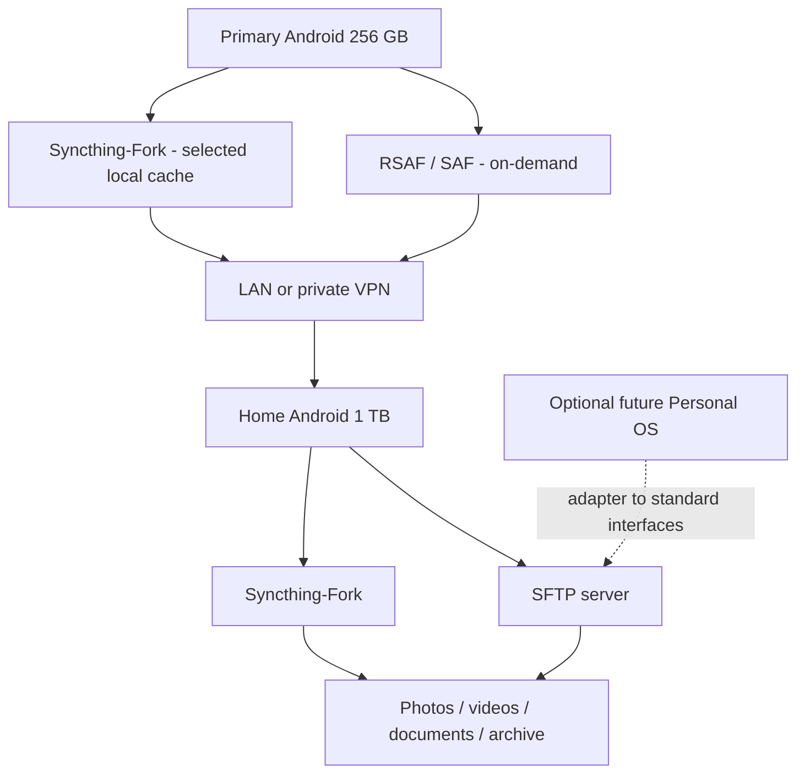

# 手机家庭存储方案 / Android Pocket NAS

[双手机软件仿真 / Two-phone software simulation](docs/SIMULATION.md)

## 中文说明

将闲置的 1 TB Android 手机留在家中作为存储节点。日常携带的 256 GB 手机按需打开远程文件，只把需要离线使用的目录同步到本地。项目独立运行，未来可通过标准协议接入 Personal OS，与 Python 仿真平台无关。

**验证状态**：架构待真机验证。OpenSSH 本地协议测试已覆盖 100 MB 文件往返；两台手机的兼容性和 72 小时无人值守运行仍待测试。

### 使用方式与边界

| 用途 | 首选组件 | 备选或限制 |
|---|---|---|
| 家庭手机提供 SFTP | SshDaemon | Primitive FTPd 或 Termux + OpenSSH |
| 主力机按需打开文件 | RSAF（rclone + Android 存储访问框架 SAF） | 支持网络协议的文件管理器；应用兼容性需实测 |
| 离线目录 | Syncthing-Fork | 仅按需访问时可跳过同步 |
| 异地访问 | Tailscale | 默认关闭路由器公网端口映射；与 Clash 冲突时评估 WireGuard 等方案 |
| 家庭机黑屏远控 | [Scrcpy Android 设备配置与部署](docs/SCREEN-CONTROL.md) | 主力机按需打开，异地复用 Tailscale，全天候重连待实测 |
| 视频播放 | NOVA Video Player | 测试支持 SFTP/WebDAV 的播放器及拖动进度条时的行为 |
| 可选网页界面 | copyparty | OpenList |
| 实验性一体化服务 | Homedroid | Termux 托管服务 |

SAF 让兼容应用通过系统文件选择器访问远程内容。手机的 `/data` 分区容量保持原值，大型游戏仍需要本地安装空间。重要数据要有独立备份，并验证恢复、充电和温控。安装候选组件前核对版本、许可证、兼容性和安全配置。

### 阅读顺序

[需求](docs/REQUIREMENTS.md) → [组件比较](docs/SOLUTIONS.md) → [架构与威胁模型](docs/ARCHITECTURE.md) → [部署](docs/SETUP.md) → [验收](checklists/ACCEPTANCE.md) → [路线图](docs/ROADMAP.md) → [Personal OS 接口](docs/PERSONAL_OS_ADAPTER.md)。

### 审阅事项与项目约定

确认两机型号、系统版本、Root 状态、Clash VPN 需求、SFTP 服务端、备份位置和保留周期。仓库已公开，发布前移除 IP、账户名、私有网络名称、二维码、凭据和恢复信息。

优先验证现有组件，再决定是否编写集成代码。复用标准文件传输、同步、浏览和 VPN 实现。记录机型差异、实测证据和待验证事项。项目文档的新增与修改同步提供中文和英文。

## English

> Reuse-first research and implementation plan for turning an idle 1 TB Android phone into a home storage node, and using it seamlessly from a 256 GB primary phone.

**Status:** architecture proposal; no device validation performed.  
**Relationship:** independent project, with optional future Personal OS adapters. Not related to the Python simulation platform.

## Goals

- 1 TB phone stays at home as an always-on storage endpoint.
- 256 GB fast primary phone accesses remote files on demand; syncs only selected hot data.
- Support both LAN and away-from-home access; avoid public inbound ports by default.
- Reuse mature FOSS apps; no custom NAS/file-sync/network stack.
- Add reliable recovery, battery/thermal checks, and independently backed-up critical data.

## Scope / non-goals

We do **not** claim to extend Android's `/data` partition or enable games to install resources remotely. SAF-enabled apps can access remote documents through providers, but compatibility varies. No phone has yet passed a 72-hour unattended test.

## Recommended baseline (test first)

| Concern | Preferred wheel | Fallback / research |
| --- | --- | --- |
| Android SFTP server | [SshDaemon](https://f-droid.org/en/packages/com.daemon.ssh/) | [Primitive FTPd](https://f-droid.org/en/packages/org.primftpd/), [Termux](https://github.com/termux/termux-app) + OpenSSH |
| Primary phone SAF access | [RSAF](https://github.com/chenxiaolong/RSAF) / rclone backends | network-aware file manager |
| Selected folder sync | [Syncthing-Fork](https://github.com/researchxxl/syncthing-android) | none needed for on-demand only |
| Private remote access | [Tailscale](https://tailscale.com/) | WireGuard or other proven VPN if Android VPN conflicts |
| Screen control with the home panel off | [Scrcpy Android profile and setup](docs/SCREEN-CONTROL.md) | On demand over LAN or Tailscale. Unattended reconnection awaits device testing. |
| Video playback | [NOVA Video Player](https://github.com/nova-video-player/aos-AVP) | client supporting SFTP/WebDAV |
| Browser file UI (optional) | [copyparty](https://github.com/9001/copyparty) | [OpenList](https://github.com/OpenListTeam/OpenList) |
| More complete phone server (experimental) | [Homedroid](https://github.com/sudiptacmd/homedroid) | Termux managed services |

> Links are research candidates, not endorsements. Check current release, license, compatibility and security before installation.

## High-level architecture

## Read in order

1. [Requirements and constraints](docs/REQUIREMENTS.md)
2. [Solution evaluation](docs/SOLUTIONS.md)
3. [Architecture and security](docs/ARCHITECTURE.md)
4. [Setup runbook](docs/SETUP.md)
5. [Acceptance matrix](checklists/ACCEPTANCE.md)
6. [Roadmap](docs/ROADMAP.md)
7. [Personal OS integration contract](docs/PERSONAL_OS_ADAPTER.md)
8. [可靠上传与回执 / Reliable upload and receipts](docs/DRIVE-M2.md)
9. [首次真机验收 / First device checks](checklists/DRIVE-M2-DEVICE.md)

## Review decisions

- [ ] Confirm device models, Android/HyperOS versions, whether root is available (default: no root).
- [ ] Confirm whether primary phone must keep Clash in VPN mode.
- [ ] Choose SshDaemon baseline vs. Termux service baseline.
- [ ] Decide backup retention and independent backup target.
- [x] Repository visibility confirmed as public.
- [ ] Before publishing evidence, redact IPs, Tailscale names, accounts, QR codes, credentials and recovery information.

Keep new and updated project documentation in Chinese and English.

## Principles

1. Test each existing component before writing glue code.
2. Avoid duplicating SFTP, WebDAV, VPN, synchronization or file browsers.
3. Prefer interoperable protocols to proprietary coupling.
4. Document every device-specific deviation and evidence.
5. Never label proposed features as verified.
