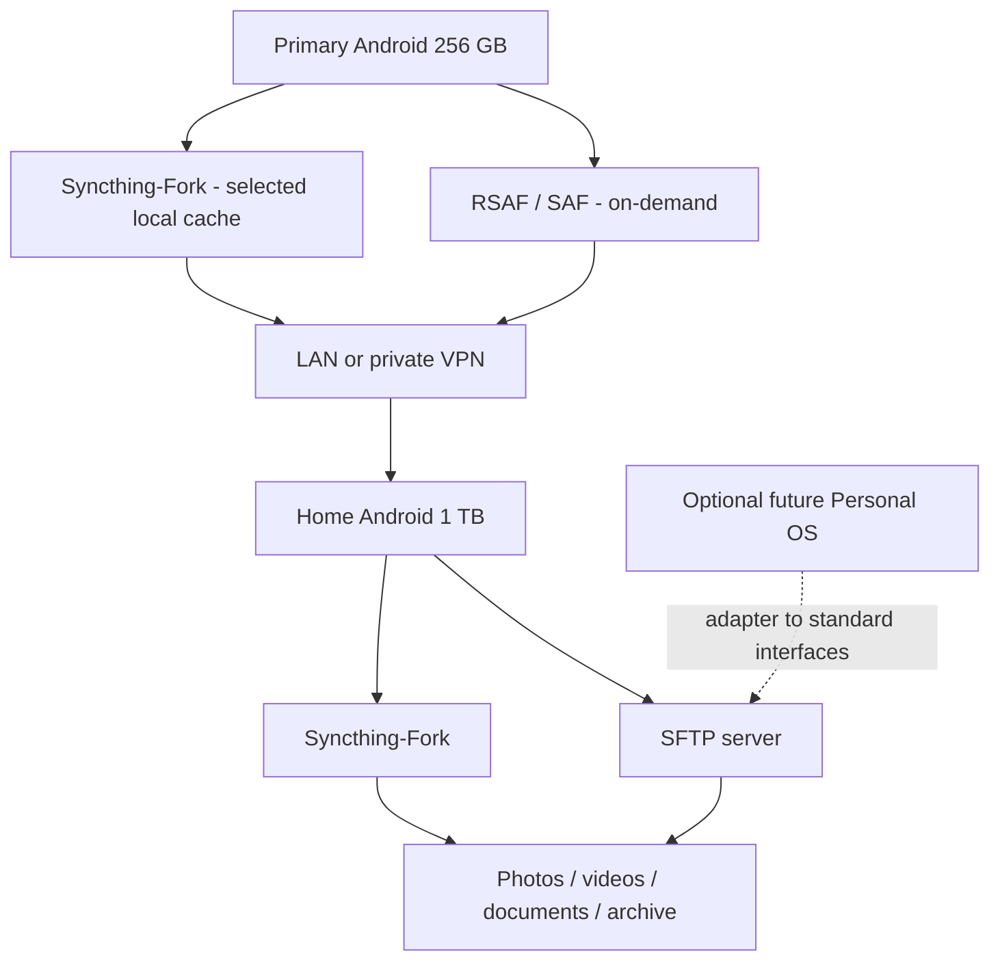

# Android Pocket NAS

> Reuse-first research and implementation plan for turning an idle 1 TB Android phone into a home storage node, and using it seamlessly from a 256 GB primary phone.

**Status:** architecture proposal; no device validation performed.  
**Relationship:** independent project, with optional future Personal OS adapters. Not related to the Python simulation platform.

## Goals

- 1 TB phone stays at home as an always-on storage endpoint.
- 256 GB fast primary phone accesses remote files on demand; syncs only selected hot data.
- Support both LAN and away-from-home access; avoid public inbound ports by default.
- Reuse mature FOSS apps; no custom NAS/file-sync/network stack.
- Add reliable recovery, battery/thermal checks, and independently backed-up critical data.

## Scope / non-goals

We do **not** claim to extend Android's `/data` partition or enable games to install resources remotely. SAF-enabled apps can access remote documents through providers, but compatibility varies. No phone has yet passed a 72-hour unattended test.

## Recommended baseline (test first)

| Concern | Preferred wheel | Fallback / research |
| --- | --- | --- |
| Android SFTP server | [SshDaemon](https://f-droid.org/en/packages/com.daemon.ssh/) | [Primitive FTPd](https://f-droid.org/en/packages/org.primftpd/), [Termux](https://github.com/termux/termux-app) + OpenSSH |
| Primary phone SAF access | [RSAF](https://github.com/chenxiaolong/RSAF) / rclone backends | network-aware file manager |
| Selected folder sync | [Syncthing-Fork](https://github.com/researchxxl/syncthing-android) | none needed for on-demand only |
| Private remote access | [Tailscale](https://tailscale.com/) | WireGuard or other proven VPN if Android VPN conflicts |
| Video playback | [NOVA Video Player](https://github.com/nova-video-player/aos-AVP) | client supporting SFTP/WebDAV |
| Browser file UI (optional) | [copyparty](https://github.com/9001/copyparty) | [OpenList](https://github.com/OpenListTeam/OpenList) |
| More complete phone server (experimental) | [Homedroid](https://github.com/sudiptacmd/homedroid) | Termux managed services |

> Links are research candidates, not endorsements. Check current release, license, compatibility and security before installation.

## High-level architecture

## Read in order

1. [Requirements and constraints](docs/REQUIREMENTS.md)
2. [Solution evaluation](docs/SOLUTIONS.md)
3. [Architecture and security](docs/ARCHITECTURE.md)
4. [Setup runbook](docs/SETUP.md)
5. [Acceptance matrix](checklists/ACCEPTANCE.md)
6. [Roadmap](docs/ROADMAP.md)
7. [Personal OS integration contract](docs/PERSONAL_OS_ADAPTER.md)

## Review decisions

- [ ] Confirm device models, Android/HyperOS versions, whether root is available (default: no root).
- [ ] Confirm whether primary phone must keep Clash in VPN mode.
- [ ] Choose SshDaemon baseline vs. Termux service baseline.
- [ ] Decide backup retention and independent backup target.
- [ ] Confirm whether repo should become public; redact IPs, Tailscale names, accounts, QR codes, credentials and recovery information.

## Principles

1. Test each existing component before writing glue code.
2. Avoid duplicating SFTP, WebDAV, VPN, synchronization or file browsers.
3. Prefer interoperable protocols to proprietary coupling.
4. Document every device-specific deviation and evidence.
5. Never label proposed features as verified.
