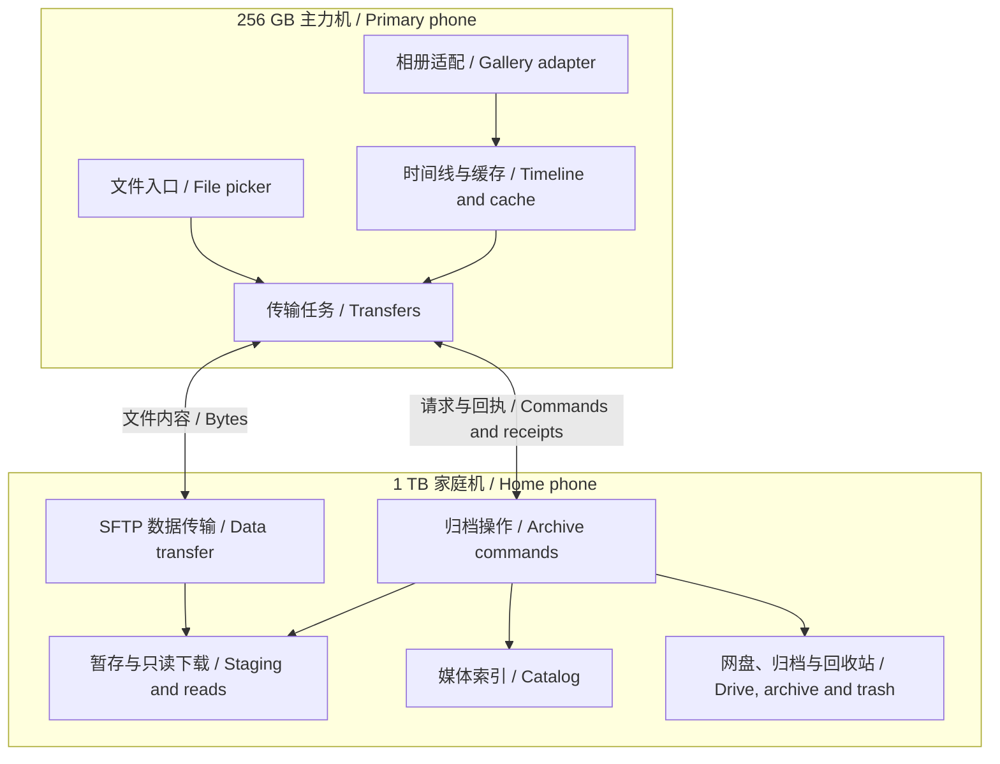

# 架构与威胁模型 / Architecture and threat model

## 选型约束 / Reuse first

先配置现有软件验证用户流程，再决定是否需要代码。下图描述逻辑职责；多个框可以由同一个成熟组件承担。优先比较完整产品，其次组合现有客户端、服务端和标准协议，最后才为已复现的缺口写最薄的适配。自建数据库、后台进程、命令 API 和 APK 均须有具体缺口才能立项。

Validate user workflows with existing software before writing code. The diagram assigns responsibilities; one mature component may cover several boxes. Evaluate complete products first, then combinations of existing clients, servers and standard protocols. Add minimal glue only for demonstrated gaps. A custom database, daemon, command API or APK requires a specific unmet requirement.

首个交付物是用现有客户端与服务端跑通 APK 下载、ZIP 上传及冲突处理的复现记录。逐项记录组件版本、配置、结果和缺口，尤其验证失败替换能否保住旧文件。媒体阶段先评估完整图库产品的复用能力及其在 1 TB Android 家庭机上的部署代价；单列 Redmi 原生相册适配状态。

The first deliverable is a reproducible APK download, ZIP upload and conflict test using existing clients and servers. Record versions, configuration, outcomes and gaps, including preservation of the old file after a failed replacement. Evaluate complete media-library products and deployment costs on the 1 TB Android host before choosing a catalog. Track Redmi gallery integration separately.

## 首版逻辑职责 / Target responsibilities

单用户、默认无 Root。普通文件使用显式上传与下载；媒体归档有独立的确认、隐藏、删除和恢复规则。家庭机保存原件和权威索引，主力机保存本地时间线、可恢复的任务、预览和短期缓存。家庭机可保存唯一原件，云端备份由用户以后在家庭端配置。

One owner, unrooted baseline. The drive supports explicit uploads and downloads. Media archiving has distinct commit, hide, delete and restore operations. The home device owns originals and the authoritative catalog. The primary owns its local timeline, durable pending work, previews and short-lived cache. A verified home original may be the only copy; cloud backup is optional.

| 层 / Layer | 实现与状态 / Implementation and status |
|---|---|
| 仿真 / Simulation | Ubuntu, Python 3, OpenSSH, rclone, Syncthing, GitHub Actions. 回环测试已通过 / Loopback tests passed. |
| 文件内容 / File bytes | SFTP；Android 服务端候选 SshDaemon 或 Termux + OpenSSH，文件入口候选 RSAF/SAF。 / Android server and picker candidates require device tests. |
| 归档业务 / Archive logic | 优先使用选定组件的索引、版本记录和任务状态。经验证仍缺持久状态时才考虑 SQLite。 / Prefer the chosen component’s catalog, version history and job state. Consider SQLite only for a demonstrated persistence gap. |
| 连接 / Connectivity | LAN；异地私有 VPN 候选 Tailscale，Clash 共存待测。 / LAN and candidate Tailscale private access; Clash coexistence unverified. |
| 系统入口 / Platform | Redmi 原生相册、文件选择器、系统分享最后适配。 / Stock gallery, picker and share integration deferred to device validation. |

家庭端提交顺序为暂存、校验、发布、返回回执。重复请求通过操作 ID 找回结果。中断后恢复程序核对暂存文件、已发布文件和日志，再决定续传或补发回执。协议层上传成功不能直接触发本地原件清理。普通文件保留两份或显式替换的决定在家庭端提交时串行处理。媒体目录的写入和删除统一经过业务操作。配对时区分当前主力机和仅可补传的旧机，并在家庭端执行权限检查。

Home commits stage, verify, publish, then acknowledge. Operation IDs identify retries. After interruption, reconcile staged and published files with the journal before resuming or returning a receipt. Local eviction requires verified archive commitment. Serialize collision decisions at drive commit time. Route mutations of managed media through archive commands. Enforce primary and migration-upload-only roles on the home device.

业务模块和命令接口是待实现设计。控制接口的传输绑定、手机端语言及 Redmi 相册能力尚未锁定。复用 Syncthing 的测试覆盖目录复制和删除传播；首版个人网盘与相册归档按各自的业务规则运行。 / Business modules and command interfaces are proposed. Control transport, Android language and Redmi gallery capabilities remain open. Syncthing tests cover replication and deletion propagation; the drive and media archive follow their own product rules.

## 中文说明

| 数据 | 存放与流向 |
|---|---|
| 冷数据 | 原始文件、视频和归档保存在家庭节点，按需读取 |
| 热数据 | 主力机保留近期媒体和手动下载的文件，可离线使用 |
| 相机文件 | 主力机上传，家庭机校验、归档并返回回执 |
| 恢复副本 | 可选的独立备份；首版允许只保留家庭机原件 |

条件允许时将 SFTP 限于可信局域网或私有 tailnet，默认关闭公网映射。服务端支持时使用专用账户和 SSH 密钥，关闭多余服务。记录开放端口、凭据轮换周期和应用版本，凭据值保存在仓库外。

| 故障 | 检查或恢复措施 |
|---|---|
| 息屏或 Doze 导致服务退出 | 检测中断、恢复并测量恢复耗时 |
| 家庭 Wi-Fi 掉线 | 验证重连和文件完整性 |
| 重启或断电 | 检查恢复服务是否需要人工解锁或启动 |
| VPN 冲突 | 验证系统支持的配置，不预设两个 Android VPN 可同时工作 |
| 同步传播误删 | 从保留版本、快照或独立备份恢复 |
| 充电异常 | 使用支持的充电限制并保持通风，异常发热或鼓包时停止运行 |

本项目负责设备部署和标准协议服务。Personal OS 可作为客户端或编排端接入，详见[适配接口](PERSONAL_OS_ADAPTER.md)。

## English

## Data roles
- **Cold data:** server-only video, archive, original files.
- **Hot data:** recent media and manually downloaded files on the primary.
- **Camera ingest:** primary uploads; home verifies, archives and acknowledges.
- **Recovery copy:** optional independent backup; the home original may be the sole copy.

## Paths and isolation
- SFTP service listens only on trusted LAN/private tailnet when feasible.
- No public router port forwarding by default.
- Use unique service account and SSH keys when supported; disable unnecessary services.
- Maintain an inventory of exposed ports, credentials lifecycle and app versions (no secrets committed).

## Failure states
- Screen-off and Doze kill server: detect/recover and measure recovery time.
- Home Wi-Fi drop: reconnect; no silent file corruption.
- Phone reboot/power loss: check whether service resumes without manual action.
- VPN client conflicts: use a supported VPN configuration, never assume two Android VPN services coexist.
- Accidental delete propagated by sync: retention/snapshot or separate backup prevents permanent loss.
- Charger/battery thermal issue: prioritize safe charge limits and ventilation; stop at abnormal heat/swelling.

## Personal OS boundary
Current project owns device-level deployment and existing protocols. Personal OS remains an optional client/orchestrator, not an implementation dependency. See PERSONAL_OS_ADAPTER.md.
